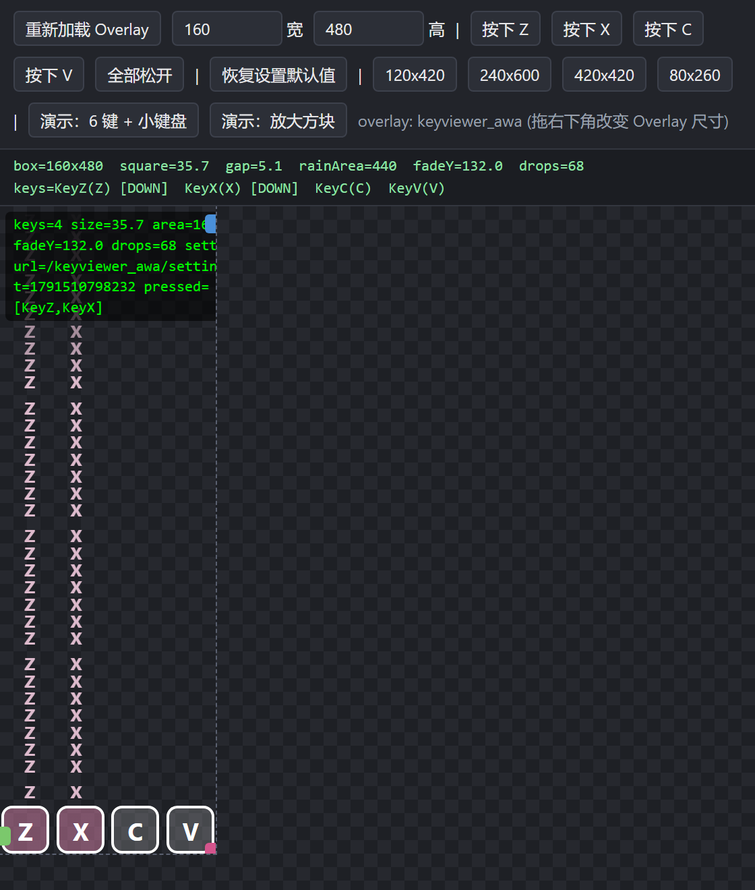

# tosu-keyviewer-awa

A key viewer overlay for [tosu](https://github.com/tosuapp/tosu): four squares,
a solid-colour key rain, and a companion fix for ManiaMapAnalyser's stuck card.

[中文说明](#中文说明) · [English](#english)



---

## English

### What it is

A tosu counter (overlay) that draws four small squares for your mania keys plus
a key rain above them. The rain follows
[KeyViewer](https://github.com/modlist-org/KeyViewer)'s behaviour: while a key is
held the bar **grows upward from the square**, stops at a maximum length, and
when released it drifts away and fades.

It is a single self-contained `index.html` — no build step, no dependencies.

### Install

1. Copy the `keyviewer_awa` folder into tosu's `static` folder:
   ```
   <tosu>/static/keyviewer_awa/
   ```
2. Add it as a counter in the tosu dashboard (it will show up by folder name).
3. Optionally put it in the in-game overlay or an OBS browser source:
   ```
   http://127.0.0.1:24050/keyviewer_awa/
   ```

Requires tosu v4.20 or newer.

### Keys

Input comes from tosu's game data, which needs **no keyboard focus** — that is
what makes it work inside OBS. tosu exposes four counter slots (`k1`, `k2`,
`m1`, `m2`); in osu!mania those are your four lane keys, in osu!standard they are
the two keys plus the mouse buttons.

The text on the squares is configurable (default `ZXCV`), one letter per line.

### Settings

34 options in the dashboard, grouped:

| Group | What is in it |
| --- | --- |
| 输入来源 / Input source | the input-source badge for troubleshooting |
| 显示 / Display | square text, show-during-play only |
| 方块外观 / Square | size, scale, gap, border, radius, letter scale |
| 颜色与透明度 / Colors | border, letter, press and release colours + opacities |
| 键雨 / Key rain | colour, opacity, speed, max length, roundness, fade, min alpha |
| 其他 / Advanced | the ManiaMapAnalyser fix, debug readout, reset |

Four settings that used to be here are now **pinned** (the Dashboard option was
removed but the feature is untouched and still reachable through `?config=`):

| Pinned value | Still selectable via |
| --- | --- |
| input source `game` | `?config={"inputMode":"keyboard"}` |
| probe time `4000` ms | `?config={"inputProbeMs":500}` |
| slots `k1 k2 m1 m2` | `?config={"gameSlots":"k1\nk2\nm1\nm2"}` |
| rain shape `bar` | `?config={"rainMode":"blocks"}` |

### The ManiaMapAnalyser card fix

ManiaMapAnalyser's card sometimes sticks on a stale visibility — visible during a
map, or hidden outside one — until its page is reloaded.

The cause is a **stale compositing layer**, not a logic error: the card does
carry `card-hidden-by-play` and the stylesheet does resolve to `opacity: 0`, but
the screen keeps showing the old frame. Because the state is correct, the
analyser's own code never sees a discrepancy and cannot recover by itself.

`mma-card-fix.zip` installs a small standalone guard into the analyser's own
page. Every 250ms it compares "what should be" (game state + the analyser's own
`Card Visibility`) against "what is", and on a mismatch — or on a visibility
transition, which is where stale frames appear — it re-asserts the class and
forces a repaint with a 1ms no-op animation. Nothing is drawn, and nothing else
about the analyser is touched.

```
INSTALL.bat      install (finds tosu by itself)
CHECK.bat        report the current state
UNINSTALL.bat    restore the analyser exactly as it was
```

The guard mirrors the analyser's own rules, including the one that hides the
card unconditionally on the main menu. Missing that rule made an earlier version
fight the analyser and flicker; there is a regression test for it now.

### Debugging

Add `?debug=1` to the overlay URL for a readout in the top-left corner. The first
line is a frame-pacing meter:

```
fps=59.8 frame=16.6/16.7/41.3ms(min/avg/max n=120)
```

The three figures together distinguish the three reasons a key rain can look
choppy:

| Reading | Meaning |
| --- | --- |
| `min ≈ avg ≈ max ≈ 16.7` | a genuine, evenly paced 60fps. Judder next to a 200fps game is a contrast effect, not a fault |
| wide spread (8 / 16.7 / 45) | frames arrive but pacing is uneven — this is fixable |
| `avg ≈ 33` (fps ≈ 30) | the host is capping the overlay |

You can also override any setting from the URL:

```
?config={"squareSize":72,"rainColor":"%23ff66aa","displayText":"A\nS\nK\nL"}
```

### Development

Everything is verified by headless tests that run against the real page source —
no browser needed:

```
node tools/keys.test.js              # key resolution, 109 checks
node tools/settings.contract.test.js # settings.json <-> overlay contract, 372
node tools/rain.test.js              # rain motion model, 28
node tools/apply-settings.test.js    # dashboard changes reach the DOM, 20
node tools/dashboard-merge.test.js   # partial broadcasts do not reset settings, 16
node tools/locked-settings.test.js   # pinned settings stay pinned, 29
node tools/frame-pacing.test.js      # the frame meter itself, 16
node tools/verify-bats-embed.js      # the .bat files carry current payloads
node tools/verify-analyser-page.js   # what tosu serves matches disk
```

`tools/serve.js` is a fake tosu for offline work: it serves the overlay, fakes
`/websocket/v2`, `/websocket/v2/precise`, the settings API and the command
channel, so the plugin can be exercised without osu! running.

### Licence

MIT — see [LICENSE](LICENSE).

---

## 中文说明

### 这是什么

一个 [tosu](https://github.com/tosuapp/tosu) 覆盖层（counter）：四个小方块显示
你的 mania 键位，上面是纯色键雨。键雨遵循
[KeyViewer](https://github.com/modlist-org/KeyViewer) 的行为 —— 按住时**从方块边缘
向上长高**，长到上限停住，松开后飘走并淡出。

单个自包含 `index.html`，无需构建、无依赖。

### 安装

1. 把 `keyviewer_awa` 文件夹放进 tosu 的 `static` 目录：
   ```
   <tosu>/static/keyviewer_awa/
   ```
2. 在 tosu dashboard 里添加为 counter（按文件夹名显示）。
3. 想放进游戏内覆盖层或 OBS 浏览器源，地址是：
   ```
   http://127.0.0.1:24050/keyviewer_awa/
   ```

需要 tosu v4.20 以上。

### 键位

输入取自 tosu 的游戏数据，**不需要键盘焦点** —— 这正是它能在 OBS 里工作的原因。
tosu 提供 4 个数据槽 `k1` `k2` `m1` `m2`；osu! mania 里就是你的 4 个键，
osu! standard 里是两个键加鼠标左右键。

方块上的文字可配置（默认 `ZXCV`），一行一个字母。

### 键雨的形状

`bar`（默认）= KeyViewer 的原始行为，按住时长高、松开后飘走。

渐出的位置由**雨条走过的距离**决定，与它多长无关 —— 所以长按出来的长条不会
一开始就淡。

### ManiaMapAnalyser 卡片卡住的修复

分析器的卡片偶尔会卡在旧的显示状态（该隐藏时不隐藏，或该显示时不显示），
刷新它的页面才恢复。

原因是**合成层帧陈旧**，不是逻辑错误：卡片确实带着 `card-hidden-by-play`，
样式表也解析出 `opacity: 0`，但屏幕上还是旧画面。因为状态是对的，分析器自己的
代码永远等不到"分歧"，没法自我修复。

`mma-card-fix.zip` 会往**分析器自己的页面**装一个小脚本：每 0.25 秒比对
「游戏状态 + 分析器自己的 Card Visibility」和「卡片实际状态」，不一致时 ——
以及可见性切换时（陈旧帧就出现在这里）—— 重新应用 class 并强制重绘一次。
重绘是一条 1ms 空动画，不改外观，分析器的其他部分一个字节都没动。

```
INSTALL.bat      安装（自己找 tosu 在哪）
CHECK.bat        查看状态
UNINSTALL.bat    卸载，恢复原样
```

脚本会照搬分析器自己的规则，包括「主菜单强制隐藏」。早期版本漏了这条规则，
结果和它打架、卡片闪烁 —— 现在有回归测试钉住。

### 排障

在 overlay 地址后加 `?debug=1`，左上角会显示读数。第一行是帧率表：

```
fps=59.8 frame=16.6/16.7/41.3ms(min/avg/max n=120)
```

三个数一起看能区分"按键雨看起来顿"的三种原因：

| 读数 | 含义 |
| --- | --- |
| `min ≈ avg ≈ max ≈ 16.7` | 真正均匀的 60fps。和 200fps 的游戏并排显得顿是对比效应，不是故障 |
| 跨度很大（8 / 16.7 / 45） | 帧都到了但节奏不匀 —— 这个可以修 |
| `avg ≈ 33`（fps ≈ 30） | 被宿主限在 30 帧 |

也可以用 URL 覆盖任意设置：

```
?config={"squareSize":72,"squareCount":4}
```

### 开发

所有验证都是直接跑真实页面源码的无头测试，不需要浏览器：

```
node tools/keys.test.js              # 键位解析，109 项
node tools/settings.contract.test.js # settings.json 与页面的契约，372 项
node tools/rain.test.js              # 键雨运动模型，28 项
node tools/apply-settings.test.js    # Dashboard 改动能到 DOM，20 项
node tools/dashboard-merge.test.js   # 局部广播不会重置其他设置，16 项
node tools/locked-settings.test.js   # 锁定项保持锁定，29 项
node tools/frame-pacing.test.js      # 帧率表本身，16 项
node tools/verify-bats-embed.js      # bat 里带的是最新脚本
node tools/verify-analyser-page.js   # tosu 送出的内容与磁盘一致
```

`tools/serve.js` 是离线开发用的假 tosu：提供 overlay、模拟
`/websocket/v2`、`/websocket/v2/precise`、设置接口和命令通道，
不开 osu! 也能调试。

### 许可

MIT，见 [LICENSE](LICENSE)。
